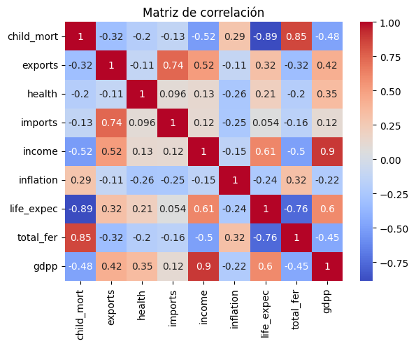
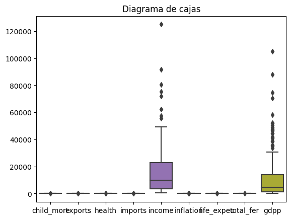
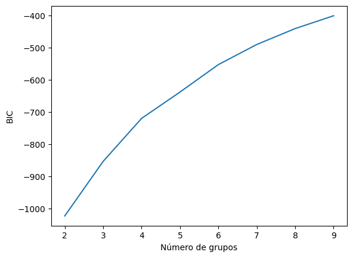

# Country Clustering with K-Means

**Grouping 167 countries by socio-economic and health indicators**

    

## Overview

Unsupervised learning to group countries according to the factors that determine their level of
development. The result helps identify which countries share similar needs (health, income, trade…).

## Dataset

**Country data** – 167 countries and 9 indicators: child mortality, exports, health spending, imports,
income per person, inflation, life expectancy, fertility rate and GDP per capita.

## Approach

1. Preprocessing and description of each indicator.
2. Correlation matrix, histograms and box plots to spot skewed variables and outliers.
3. Scaling with `StandardScaler`.
4. Cluster stability with jackknife resampling.
5. Choice of the number of groups with the elbow method and the BIC of Gaussian Mixture models.
6. K-Means, evaluated with silhouette and Davies-Bouldin scores.
7. Profiling of every group.

## Results

| Metric (K-Means, k = 4) | Value |
| --- | --- |
| Silhouette score | 0.243 |
| Davies-Bouldin score | 1.24 |

Child mortality separates the groups clearly: from an average of **97.8** deaths per 1,000 births in the
least developed group to **6.7 – 7.2** in the most developed ones.

<table>
  <tr><td align="center" valign="top"> Correlation between indicators</td><td align="center" valign="top"> Box plots of the indicators</td><td align="center" valign="top"> BIC by number of groups</td></tr>
</table>

## How to run

Open the notebook in Colab with the badge above and upload `Country-data.csv`.

*The notebook is written in Spanish.*

---

Made by <b>Steven Macas</b> — Data Engineer &amp; Data Analyst · <a href="https://gointy.com">gointy.com</a> · <a href="https://www.linkedin.com/in/steven-macas">LinkedIn</a> · <a href="https://github.com/Steven-Macas">GitHub</a>
